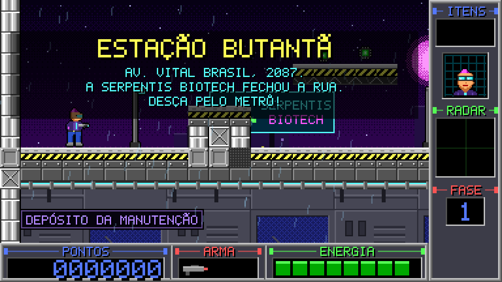
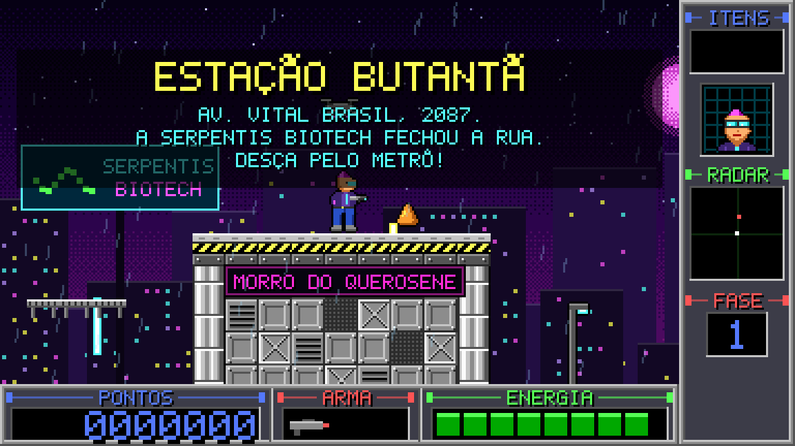
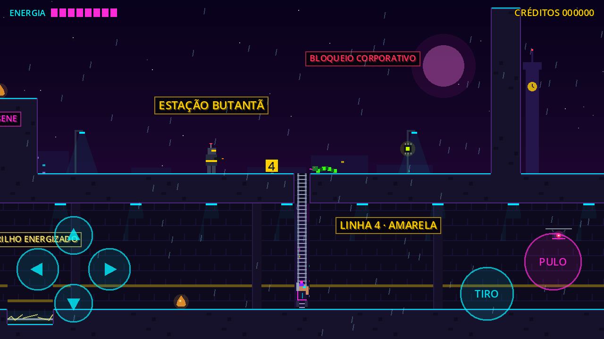

# Neon Butantã

Jogo de plataforma e tiro 2D no estilo do clássico **Duke Nukem II** (1993), com
pixel art e HUD no estilo dos jogos de PC daquela época, tema **cyberpunk** e fases
baseadas na região do **Butantã / Rio Pequeno**, em São Paulo.
Feito em **Godot 4** para **Android**, mas também roda no PC.





## O que já funciona

**Fase 1 – Estação Butantã:** rua bloqueada na Av. Vital Brasil, descida pelo metrô,
cartão vermelho e porta da plataforma.

**Fase 2 – Instituto Butantan:** parque com o fosso do serpentário (tem segredos lá
embaixo), laboratório de dois andares da Serpentis, cartão azul e a luta contra a
chefe **JARARACA-X**, uma cobra gigante que rasteja, se ergue e cospe veneno. A saída
só abre depois que ela é derrotada.

**Fase 3 – Cidade Universitária:** Portão 1 da USP, biblioteca sobre pilotis com o
cartão vermelho no terraço, a Raia Olímpica atravessada em **plataformas móveis**,
o bandejão com barraquinha de dogão e, na Praça do Relógio, o chefe **CRONOS-X**: o
relógio da torre virou um drone gigante. Ele voa sobre a praça e só o tiro para cima
o alcança.

Em todo o jogo:

- Herói (Duca Neon) que anda, pula (com pulo curto/longo), sobe escadas, desce de plataformas e atira
- Inimigos: androide de segurança, drone de vigilância e cobra cibernética
- Tiro para cima (segure ↑), para derrubar os drones; mirando para cima, a câmera
  também sobe para mostrar o que vem lá de cima
- Barraquinhas de dogão que enchem a energia (e fecham por 30 s depois de servir)
- Itens: coxinha energética (vida), cartão de acesso vermelho, turbo no blaster, chips de dados (pontos)
- Porta de laser que só abre com o cartão, lodo tóxico, trilho energizado
- Pixel art no estilo Duke Nukem II: blocos de metal com faixas zebradas, caixas, painéis
  industriais ao fundo e contorno preto nos personagens
- Fundo da cidade com parallax (Torre do Relógio da USP ao longe), chuva e letreiros de neon
- HUD com moldura de canos: itens, retrato do herói, radar de inimigos, fase, pontos,
  arma e energia
- Fonte pixelada própria (com acentos) e controles de toque na tela
- Efeitos sonoros e trilha synthwave/chiptune para cada fase, mais a música dos chefes
  (tecla **M** liga e desliga a música)

## Como abrir e jogar no PC

1. Baixe o **Godot 4.7** (versão padrão, não a .NET): https://godotengine.org/download
2. Abra o Godot, clique em **Importar** e escolha o arquivo `project.godot` desta pasta.
3. Aperte **F5** para jogar.

| Ação | Teclado | Controle |
|---|---|---|
| Andar | ← → ou A D | Direcional |
| Subir/descer escada | ↑ ↓ ou W S | Direcional |
| Pular | Espaço, Z ou K | A |
| Atirar | X, J ou Ctrl | X |
| Atirar para cima | ↑ + Atirar | Cima + X |
| Descer da plataforma | ↓ + Pular | Baixo + A |
| Continuar/reiniciar | Enter ou R | Start |
| Ligar/desligar música | M | Select |

No celular, o direcional da esquerda é analógico, com 8 direções. Arrastando o dedo
na diagonal, dá para andar e mirar para cima ao mesmo tempo.

Para ver os controles de toque no PC, em **Depurar → Personalizar argumentos de execução**
coloque `-- --touch`. O mouse simula o dedo.

## Como gerar o APK para Android (Windows)

O projeto usa o **Godot 4.7**. Os passos 1 a 4 são feitos uma vez só.

**1. Android SDK (pelo Android Studio)**

1. Instale o Android Studio: https://developer.android.com/studio
2. Abra o Android Studio e vá em **More Actions → SDK Manager**. Se já houver um
   projeto aberto, o caminho é **Tools → SDK Manager**.
3. Na aba **SDK Platforms**, marque a versão mais nova do Android (por exemplo, Android 15
   / API 35).
4. Na aba **SDK Tools**, marque **Show Package Details** (canto de baixo) e instale:
   - **Android SDK Build-Tools**: marque a versão mais nova, por exemplo 35.0.1. Sem
     ela aparece o erro *"Unable to open Android 'build-tools' directory"*.
   - **Android SDK Command-line Tools (latest)**
   - **Android SDK Platform-Tools**
5. Clique em **Apply** e espere baixar.
6. Anote o caminho que aparece no alto, em **Android SDK Location**. Normalmente é
   `C:\Users\SEU_USUARIO\AppData\Local\Android\Sdk`.

**2. Java (JDK 17)**

Instale o **Temurin JDK 17** em https://adoptium.net (escolha a versão 17 LTS, Windows,
.msi). Ele fica em algo como `C:\Program Files\Eclipse Adoptium\jdk-17.0.xx-hotspot`.

**3. Configurar o Godot**

1. **Editor → Configurações do Editor → Exportar → Android**:
   - **Java SDK Path**: a pasta do JDK 17 do passo 2.
   - **Android SDK Path**: a pasta anotada no passo 1.
2. Feche e abra o Godot de novo.

**4. Modelos de exportação**

**Editor → Gerenciar Modelos de Exportação → Baixar e Instalar** (cerca de 1 GB).

**5. Gerar o APK**

1. **Projeto → Exportar…** O preset "Android" já está configurado.
2. Clique em **Exportar Projeto** e salve como `NeonButanta.apk`.
3. Copie o APK para o celular e abra para instalar. É preciso permitir "instalar apps
   de fontes desconhecidas" quando o Android pedir.

Também dá para ligar o celular no USB com a **Depuração USB** ativa (em Opções do
desenvolvedor). Aí aparece um ícone do Android no canto do editor, e um clique instala
e roda o jogo direto no aparelho.

**Se aparecer "Unrecognized UID" ou "Failed to create an autoload"**: baixe a versão
nova do projeto numa **pasta nova**, sem copiar por cima da antiga. Se preferir
consertar à mão: **Projeto → Configurações do Projeto → Globais → Autoload**, remova
`Audio` e adicione de novo `res://scripts/audio.gd` com o nome `Audio`.

## Gráficos (pasta `art/`)

Todos os PNGs da pasta `art/` são gerados pelo script `tools/gen_art.py`. Os
personagens e itens estão desenhados lá com letras (cada letra é uma cor da paleta),
e o contorno preto é colocado automaticamente. Para mudar um desenho:

- **Pelo script:** edite as letras e rode `python3 tools/gen_art.py` (precisa do
  Python 3 com `pip install pillow`).
- **Direto no PNG:** abra a imagem no Aseprite, LibreSprite ou Piskel e mantenha o mesmo
  tamanho de quadro. Nesse caso, não rode o script de novo, ou ele sobrescreve a imagem.

| Arquivo | Conteúdo |
|---|---|
| `hero.png` | Herói: parado, 3 de corrida, pulo, 2 de escada e os mesmos mirando para cima (32×32 cada) |
| `guard.png`, `drone.png`, `snake.png` | Inimigos (2 quadros cada) |
| `items.png`, `exit.png` | Itens (coxinha, cartões, turbo, chip) e porta de saída |
| `boss.png` | JARARACA-X: 2 quadros rastejando e 1 erguida cuspindo (80×48) |
| `boss_clock.png` | CRONOS-X: 2 quadros voando e 1 atacando (64×48) |
| `platform.png` | Plataforma móvel com propulsores (2 quadros) |
| `plant.png` | Planta tropical decorativa |
| `hotdog.png` | Barraquinha de dogão (aberta e fechada) |
| `tiles.png` | Blocos 16×16 (a ordem está em `scripts/level_art.gd`) |
| `bg_*.png` | Fundos: céu, prédios distantes, camada próxima de cada fase (`bg_near`, `bg_butantan`, `bg_usp`) e paredes internas (`bg_tech`, `bg_lab`) |
| `portrait.png`, `font.png`, `lamp.png` | Retrato do HUD, fonte e poste |

O jogo roda em 384×216 pixels e é ampliado para a tela, como os jogos de 1993.

## Sons e músicas (pasta `audio/`)

Todos os sons são sintetizados pelo script `tools/gen_audio.py`, que precisa do Python 3
com `pip install numpy`. São ondas quadradas, dente-de-serra e ruído, como nos chips
de som dos anos 90.

- **Efeitos** (`audio/sfx/`): tiro, pulo, explosão, dano, itens, cartão, porta, dogão,
  chefe, fim de fase e morte. Cada um é uma função `sfx_*` no script.
- **Músicas** (`audio/music/`): `fase1`, `fase2`, `fase3` e `boss`. Cada uma está descrita
  em `TRACKS`, com andamento (bpm), tom, acordes, baixo, arpejo e bateria (`x` = toca).
  A melodia é sorteada a partir de `seed`: troque o número para ouvir outra.

Depois de mudar, rode `python3 tools/gen_audio.py`. As músicas tocam em loop: isso está
configurado nos arquivos `.import` delas (Godot, aba Importar → Loop Mode: Forward).
Cada fase escolhe sua música pela constante `MUSIC` no arquivo da fase.

## Como criar ou editar fases

As fases ficam em `levels/` e são desenhadas com caracteres, um por bloco de 16×16 px.
A legenda está no topo de `levels/fase1_estacao_butanta.gd`. Para criar uma fase nova:

1. Copie o arquivo de uma fase e mude `NAME`, `SUBTITLE`, `SIGNS` (letreiros) e `MAP`.
   Os opcionais `INTERIOR_BG` e `BACKDROP_NEAR` trocam a parede de fundo e o cenário
   da cidade (veja a fase 2).
2. Adicione o arquivo na lista `LEVELS` em `scripts/main.gd`.

Dica: o pulo alcança 3 blocos de altura e uns 4 de distância.

## Estrutura

```
project.godot          configuração (resolução 384x216, paisagem, renderizador mobile)
art/                   pixel art (PNG) gerada por tools/gen_art.py
tools/gen_art.py       gerador da pixel art
scenes/main.tscn       cena principal
scripts/main.gd        lê o mapa, cria colisões e entidades, controla morte/vitória
scripts/player.gd      herói: movimento, escada, tiro, dano
scripts/enemy_*.gd     inimigos (base + segurança, drone, cobra e os chefes Jararaca-X e CRONOS-X)
scripts/pickup.gd      itens e saída
scripts/door.gd        porta de laser
scripts/moving_platform.gd plataforma móvel
scripts/boss_base.gd   base dos chefes (vida, barra, música, saída travada)
scripts/hotdog_stand.gd barraquinha de dogão
scripts/level_art.gd   desenho dos blocos, parede de fundo, escadas e letreiros
scripts/hazard_art.gd  lodo tóxico e trilho energizado animados
scripts/background.gd  céu e prédios com parallax
scripts/rain.gd        chuva
scripts/hud.gd         interface no estilo Duke Nukem II
scripts/pixel_font.gd  fonte pixelada
scripts/audio.gd       efeitos e música (autoload "Audio")
audio/                 sons (WAV) gerados por tools/gen_audio.py
tools/gen_audio.py     gerador dos sons e músicas
scripts/touch_controls.gd  botões na tela do celular
levels/                mapas das fases
tests/smoke_test*.*    testes automáticos que jogam as fases 1, 2 e 3
docs/GDD.md            documento de design (história, fases, inimigos, ideias)
```

## Teste automático

```
godot --path . res://tests/smoke_test.tscn -- /tmp/prints
godot --path . res://tests/smoke_test_fase2.tscn -- /tmp/prints
godot --path . res://tests/smoke_test_fase3.tscn -- /tmp/prints
```

O da fase 1 atira para cima no drone, usa a barraquinha de dogão, desce a escada do
metrô, pega o cartão, abre a porta e chega na saída. O da fase 2 desce no fosso do
serpentário, pega o cartão azul, derrota a Jararaca-X e sai. O da fase 3 sobe na
biblioteca, pega carona na plataforma móvel, testa a água da Raia e derruba o CRONOS-X
com tiro para cima. Todos imprimem cada
etapa e salvam prints na pasta indicada.
